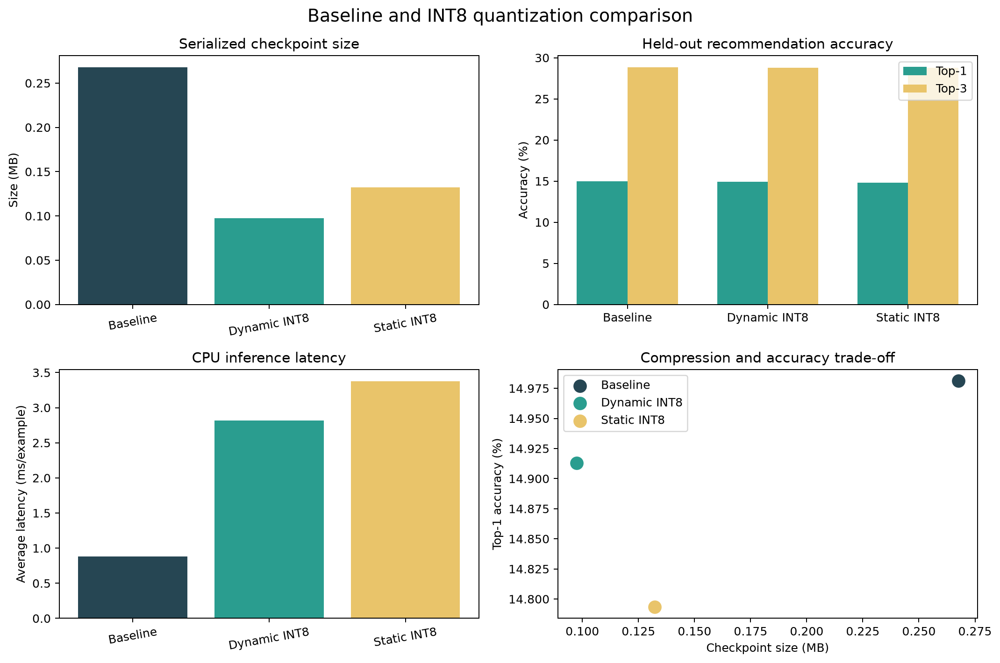
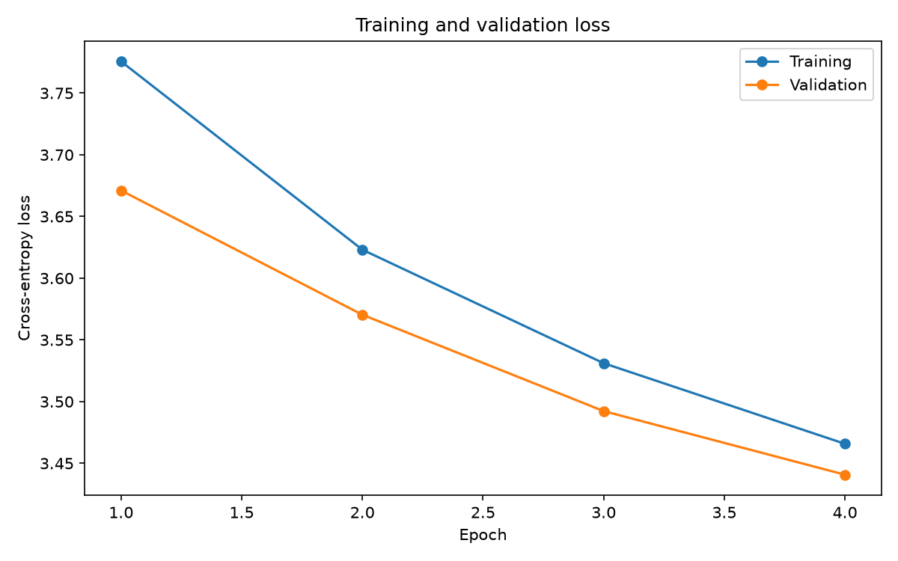

# Quantized Retail Recommender

A reproducible, laptop-friendly demonstration of next-item retail recommendations
and post-training quantization. A compact causal Transformer learns product
co-occurrence patterns from synthetic shopping baskets. The saved baseline, dynamic
INT8, and calibrated static INT8 models are evaluated on the same held-out transactions.

> **Model provenance:** the Transformer is trained from scratch. This project does not
> download a pretrained language model or perform continued pretraining. The recommender
> and dashboard do not call a hosted AI service or require API credentials.

## Problem and objectives

Retailers often recommend complementary products, but large hosted models are not
necessary for a small next-item task. This project demonstrates how to:

1. Prepare a reproducible synthetic retail basket dataset.
2. Train a compact autoregressive model to predict the next product.
3. Compare model predictions with empirical association rules.
4. Measure the accuracy, checkpoint size, and CPU latency of baseline and INT8 models.
5. Explore the results in an interactive Streamlit dashboard.

## How it works

```text
Synthetic baskets
       │
       ├── clean, deduplicate, tokenize
       ├── split whole transactions into train / validation / test
       ├── create within-basket next-item prefixes
       │
       ├── causal Transformer ──> Top-1 / Top-3 / Top-5 predictions
       ├── training-split itemsets ──> support / confidence / lift rules
       │
       ├── baseline checkpoint
       ├── dynamic INT8 checkpoint
       └── calibrated static INT8 checkpoint
                    │
             held-out comparison
                    │
             Streamlit dashboard
```

The Transformer and association-rule recommendations are distinct methods. Transformer
scores are model probabilities; association-rule scores report empirical confidence.

## Dataset and preprocessing

The checked-in CSV contains **10,000 synthetic transactions** covering **42 products**
in 11 retail categories. It includes intentionally correlated groups such as milk/cereal,
bread/butter, chips/soft drinks, pasta/pasta sauce, and coffee/sugar, with randomness
and additional items in each basket.

`src/dataset.py` provides reproducible generation, cleaning, duplicate removal,
tokenization, analysis, and transaction splitting. Product IDs are separate from PAD,
BOS, EOS, and UNK special tokens. The data is split by complete transaction (80% train,
10% validation, 10% test; seed 42) **before** prefix examples are constructed, preventing
prefixes from the same basket crossing partitions.

Current split: 8,000 training transactions, 1,000 validation transactions, and 1,000
held-out test transactions. The held-out split yields 5,854 next-item examples.

## Model and training

The model in `src/model.py` is a compact autoregressive Transformer:

- Product embeddings and learned positional embeddings.
- Two Transformer blocks, each with four-head causal self-attention and a feed-forward
  network.
- Layer normalization, GELU, dropout, and a vocabulary-sized output projection.
- Maximum context length 12, embedding width 48, dropout 0.1.
- 61,678 baseline parameters; 46 vocabulary entries (42 products plus four special tokens).

Training in `src/train.py` uses next-item cross-entropy and AdamW, with seed 42,
batch size 256, learning rate `3e-4`, and four epochs in the saved run. Training loss
decreased from 3.7756 to 3.4658; validation loss decreased from 3.6711 to 3.4408.
Artifacts include the full baseline model, a state-dict checkpoint, model configuration,
training metrics, and a loss plot.

## Recommendations and itemset probing

`src.recommend.recommend_next(...)` accepts product names or product IDs, handles
variable-length baskets, excludes already-purchased products, and returns ranked
product names, categories, IDs, and probabilities. `recommend_top_k(...)` returns
separate Top-1, Top-3, and Top-5 lists.

`mine_frequent_itemsets(...)` enumerates bounded item combinations and derives
association rules. The saved evaluation mines rules from training transactions only
(minimum support 0.005, minimum confidence 0.20, maximum itemset size 3). For a selected
basket, `probe_itemsets(...)` returns associated products with support, confidence, and
lift. Test transactions are not used to fit these rules.

Run the held-out model-versus-rules evaluation with:

```powershell
python -m src.evaluate_recommendations
```

## Dynamic and static INT8 quantization

Quantization is performed on CPU using the installed PyTorch quantization backend.
The original baseline checkpoint is kept separate.

- **Dynamic INT8:** PyTorch eager dynamic quantization of supported `Linear` layers.
  Weights use qint8; activation quantization occurs at runtime.
- **Static INT8:** eager static post-training quantization. Activation observers are
  calibrated on 2,048 prefixes from the training split (32 batches of 64), then
  supported `Linear` modules are converted to real quantized operators.

Both quantized checkpoints contain 13 qint8 Linear operators. Embeddings, layer
normalization, GELU/dropout, attention matrix multiplications, softmax, masking, and
other unsupported Transformer operations remain floating point. Static quantization
is therefore a supported-layer static path, not a fully integer Transformer.

Create separate quantized artifacts with:

```powershell
python -m src.quantize_models
```

The command checks that the baseline matches its saved evaluation hash, calibrates only
on training examples, saves each model and configuration separately, and verifies
loading and inference. PyTorch eager quantization APIs emit deprecation warnings in the
tested PyTorch release; migration to TorchAO is a future improvement.

## Measured model comparison

The following values come from the checked-in
`results/quantization_comparison.json` and CSV. All models were evaluated on the same
5,854 held-out examples. Checkpoint size is decimal MB (1 MB = 1,000,000 bytes);
accuracy changes are relative to the baseline.

| Model | Checkpoint (MB) | Parameters | Top-1 | Top-3 | Test loss | CPU latency (ms/example) | Size reduction | Top-1 change |
|---|---:|---:|---:|---:|---:|---:|---:|---:|
| Baseline | 0.267685 | 61,678 | 14.9812% | 28.8179% | 3.444107 | 0.884530 | — | — |
| Dynamic INT8 | 0.097561 | 61,678 | 14.9129% | 28.7837% | 3.444339 | 2.820036 | 63.55% | −0.0683 pp (−0.46% relative) |
| Static INT8 | 0.132309 | 61,678 | 14.7933% | 28.7837% | 3.444546 | 3.374526 | 50.57% | −0.1879 pp (−1.25% relative) |

On this CPU run, the baseline had the highest measured recommendation accuracy and
lowest latency. Dynamic INT8 achieved the greatest compression and was the better of
the two quantized variants for Top-1 accuracy, but its measured latency was 218.82%
slower than baseline. Static INT8 was 281.50% slower. These timings are machine- and
runtime-dependent and should not be generalized to other hardware.

The comparison command reloads all three saved checkpoints, verifies dataset and test
example fingerprints, and regenerates the actual metrics and visualizations:

```powershell
python -m src.evaluate_quantization
```

Outputs:

- `results/quantization_comparison.csv`
- `results/quantization_comparison.json`
- `results/quantization_comparison.png`





## Dashboard

Launch the saved-artifact dashboard from the project root:

```powershell
python -m streamlit run app/main.py
```

It includes:

1. **Project overview** — dataset and model-size KPIs, measured compression, and model
   description.
2. **Shopping basket recommendations** — product selection or typed input, Top-1/3/5
   Transformer recommendations, and an optional full-width three-model comparison.
3. **Frequently bought together** — itemset filtering and basket-based rule probing,
   with support, confidence, and lift.
4. **Quantization comparison** — actual comparison table, accuracy/size/latency charts,
   and a measured trade-off summary.
5. **Dataset analytics** — product frequency, category distribution, basket sizes, and
   common combinations.

Models and data are cached during the app session. The dashboard does not train or
quantize on startup. It reports missing artifacts and displays actionable messages
instead of silently substituting fabricated values. A project-level light theme keeps
text readable across browser color-scheme preferences; navigation adapts to viewport size.

## Installation and use (Windows PowerShell)

Python **3.12** is the supported and tested version. From the project root:

```powershell
py -3.12 -m venv .venv
.\.venv\Scripts\Activate.ps1
python -m pip install --upgrade pip
python -m pip install -r requirements.txt
```

If PowerShell prevents environment activation, either adjust the local execution policy
as appropriate for your computer or invoke the environment directly:

```powershell
.\.venv\Scripts\python.exe -m pytest -q
```

For another operating system, use its standard Python 3.12 virtual-environment
activation command. CPU is supported. Training detects CUDA when available; the
quantized model artifacts and comparison latency measurements are CPU-oriented.

### Run an existing saved project

The checked-in dataset and model artifacts can be used without retraining:

```powershell
python -m src.evaluate_baseline
python -m src.evaluate_recommendations
python -m src.quantize_models
python -m src.evaluate_quantization
python -m streamlit run app/main.py
```

`src.quantize_models` checks the baseline hash against `results/baseline_metrics.json`.
Run baseline evaluation after changing/retraining the baseline and before regenerating
quantized artifacts.

### Train and regenerate the experiment

To train on the checked-in dataset:

```powershell
python -m src.train
```

To regenerate the synthetic data and run the complete training pipeline:

```powershell
python -m src.pipeline --force-data --transactions 10000 --epochs 4
python -m src.evaluate_baseline
python -m src.evaluate_recommendations
python -m src.quantize_models
python -m src.evaluate_quantization
```

**This workflow regenerates the dataset and overwrites the baseline checkpoint.** Do not
run it if you need to preserve the current trained model. The evaluation commands save
reports under `results/`; latency results can vary between runs.

### Tests

Run the complete test suite from the project root:

```powershell
python -m pytest -q
```

Tests cover data preparation, transaction splitting, tokenization, model loading and
inference, recommendations, itemset metrics, baseline evaluation, dynamic/static
quantization, comparison calculations, and dashboard sections/interactions.

## Project structure

```text
quantized-retail-recommender/
├── .github/workflows/ci.yml
├── .streamlit/config.toml       Consistent high-contrast light theme
├── app/
│   ├── main.py                 Streamlit dashboard
│   ├── llm.py                  Optional OpenAI-compatible chat helper; not used by recommender
│   └── storage.py              Small JSON store helper
├── data/
│   ├── product_vocabulary.json
│   └── retail_transactions.csv
├── models/
│   ├── baseline_model.pth
│   ├── baseline_model_state_dict.pth
│   ├── baseline_model_config.json
│   ├── dynamic_int8/
│   │   ├── model.pth
│   │   └── quantization_config.json
│   └── static_int8/
│       ├── model.pth
│       └── quantization_config.json
├── notebooks/quantized_retail_recommender.ipynb
├── results/
│   ├── baseline_metrics.json
│   ├── quantization_artifacts.json
│   ├── quantization_comparison.csv
│   ├── quantization_comparison.json
│   ├── quantization_comparison.png
│   ├── recommendation_evaluation.json
│   └── performance_plots/
├── src/
│   ├── dataset.py
│   ├── model.py
│   ├── train.py
│   ├── recommend.py
│   ├── evaluate.py
│   ├── evaluate_baseline.py
│   ├── evaluate_recommendations.py
│   ├── quantization.py
│   ├── quantize_models.py
│   ├── evaluate_quantization.py
│   └── pipeline.py
├── tests/
├── .env.example
├── .gitignore
├── Dockerfile
├── pytest.ini
├── requirements.txt
└── README.md
```

The optional `app/llm.py` helper is separate from the recommender and is not imported
by the dashboard. `.env.example` contains placeholders only; never put real credentials
there. The runtime dependencies are Streamlit, PyTorch, NumPy, pandas, Matplotlib,
Plotly, and HTTPX (for the optional helper); pytest is used for testing.

## Environment verified

The checked-in results and tests were verified with Python 3.12.10, PyTorch 2.10.0+cpu,
Streamlit 1.67.0, pandas 3.1.1, NumPy 2.5.5, Matplotlib 3.11.2, Plotly 7.1.0, and
HTTPX 0.28.1. PyTorch is constrained below 2.11 in `requirements.txt` because the current
eager quantization implementation needs a migration before that boundary.

## Limitations and future improvements

- Transactions are synthetic; their associations are deliberately structured and do not
  establish real-world retail performance.
- The model is small and the observed recommendation accuracy is modest.
- Static quantization covers supported Linear layers only; attention and other operations
  remain floating point.
- On the measured CPU, INT8 variants were smaller but slower than the baseline.
- PyTorch eager quantization APIs are deprecated; migrate the quantization path to
  TorchAO and revalidate the saved operators.
- Further work could evaluate real anonymized transactions, larger validation sets,
  batched serving, more complete integer execution, and cross-hardware benchmarks.

## GitHub preparation and artifact handling

The repository includes its small dataset, trained checkpoints, evaluation reports, and
plots so the demo can be run immediately. The largest checked-in artifacts are under
1 MB; Git LFS is not needed for the current files. `.gitignore` excludes virtual
environments, `.env` files (except the placeholder `.env.example`), caches, and
temporary/editor files while leaving the reproducibility artifacts under `data/`,
`models/`, and `results/` available to Git.

No GitHub repository is created and no files are pushed by this project workflow.
